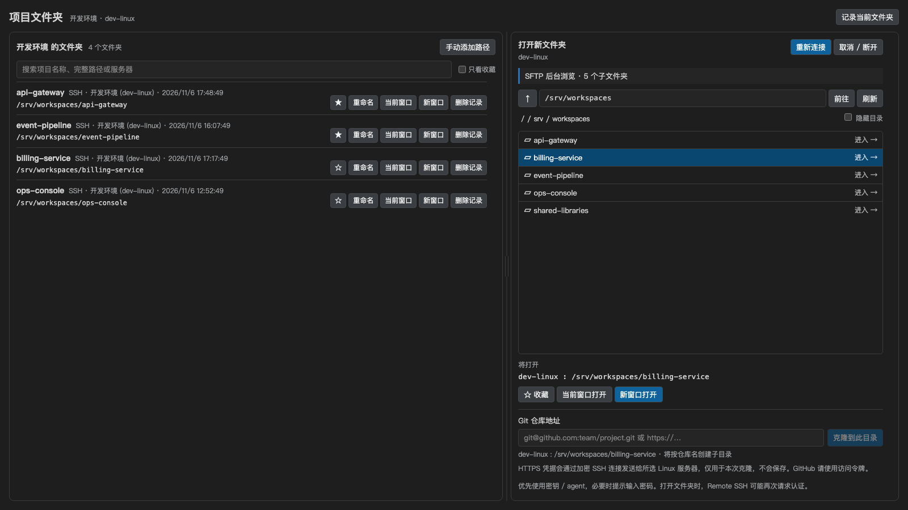
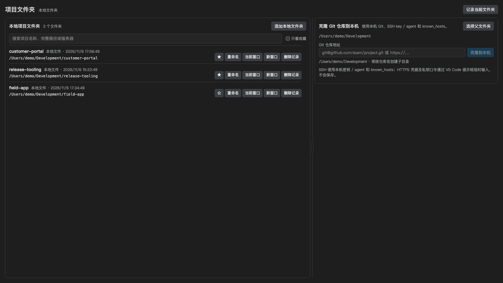
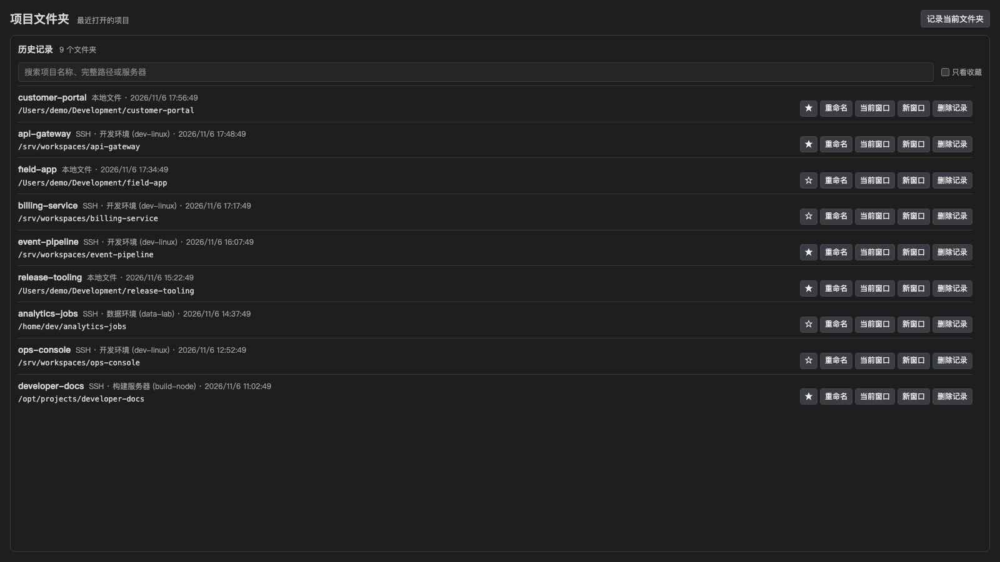

# SSH Workspace Manager

在 VS Code 中集中管理本地与 SSH 服务器项目文件夹。左侧选择服务器、本地文件、历史记录或收藏记录，右侧查看完整路径、来源和最近打开时间，也可以直接浏览服务器目录。

适用于 **macOS / Windows 本机连接 Linux 服务器**。需要 Microsoft **Remote - SSH**、本机 OpenSSH；使用本地克隆时还需要本机 Git，使用远程克隆时 Linux 服务器需要 Git。

## 功能预览

以下截图展示主要使用场景，服务器、路径和项目名称均为演示数据。

### 浏览远程项目

从服务器项目列表快速打开常用目录，也可以浏览远程文件夹、选择目标位置并克隆 Git 仓库。

### 管理本地项目

集中查看本地工作区，并将 Git 仓库克隆到本机后直接在当前窗口或新窗口打开。

### 搜索历史项目

在同一列表中搜索本地和各 SSH 服务器上实际打开过的项目，收藏、移除记录或选择窗口打开。

## 开始使用

1. 安装本扩展，按提示安装 Microsoft **Remote - SSH**。
2. 点击左侧活动栏的 **SSH Manager** 图标，管理页会直接打开。
3. 在左侧选择服务器。已有 SSH 配置会自动导入，也可以点击服务器栏右上角 **+** 新增。
4. 点击项目的 **当前窗口** 或 **新窗口** 打开文件夹；本地项目使用 VS Code 本机窗口，SSH 项目由 Remote SSH 打开。

也可以从命令面板执行 **SSH Manager: 打开管理页 / Open Dashboard**，或点击底部状态栏 **SSH Manager**。图标被隐藏时，右击活动栏并勾选 **SSH Manager**。

## 管理服务器

服务器列表位于 VS Code 侧边栏，每台服务器带有服务器图标。选择 **全部服务器** 可以跨服务器搜索项目。

- **新增服务器**：输入 SSH 别名、地址、用户、端口和可选私钥路径，确认后追加到本机 SSH 配置。
- **从 SSH 配置导入**：选择已有 Host 别名，或恢复之前删除的服务器。
- **添加已知 SSH 别名**：只添加管理记录，适用于已有可连接的别名。
- **删除服务器**：悬停服务器后点击垃圾桶。从服务器列表隐藏，刷新后也不会重新出现；SSH 配置和文件保留。全局历史和收藏中的项目仍可打开，重新导入可恢复服务器入口。
- **刷新 / SSH 配置**：使用服务器栏标题处的按钮刷新列表或编辑配置。

优先读取 `remote.SSH.configFile`，未设置时读取本机 `~/.ssh/config`（Windows 为用户目录下的 `.ssh/config`）。支持具体 Host 和 Include；通配 Host 不单独列出。新建条目追加在配置末尾，现有 OpenSSH 的规则顺序仍然生效。

## 本地、历史与收藏

- **本地文件**：自动记录当前 VS Code 实际打开的本地工作区，也可以选择多个本地文件夹手动加入。
- **历史记录**：显示所有实际打开过的本地和 SSH 文件夹，按最近打开时间排序；同一位置重复打开只更新这一条记录。
- **收藏记录**：显示所有收藏的本地和 SSH 文件夹。这里的“取消收藏”只移出收藏列表，历史记录仍保留。
- 这些入口都支持按项目名称、完整路径或服务器搜索。历史记录中的“删除记录”会删除这条记录；服务器上的文件夹和本地文件不会被删除。
- 宽且足够高的窗口中，项目清单与目录浏览 / 本地克隆并排展示，长列表独立滚动；可拖动两栏间的分隔线调整宽度，也可聚焦后用左右方向键微调，两种页面分别记住比例。窄窗口改为上下排列，短窗口仍可滚动访问全部操作。项目名称、完整路径和操作按钮使用紧凑排版，方便同时查看更多项目。

在 **本地文件** 页的克隆区域，可以选择本机父文件夹并输入 SSH 或 HTTPS 仓库地址。扩展使用本机 Git 和 OpenSSH 配置；SSH 优先使用本机 SSH key / agent。HTTPS 用户名、密码 / 令牌及加密私钥口令会由 VS Code 提示输入，通过临时本机进程间通道交给 Git，不会保存到项目记录或日志。按仓库名创建子目录，界面显示 Git 阶段和可用的对象进度，也可以取消。

克隆完成后，页面顶部会保留结果和完整路径，并提供当前窗口 / 新窗口打开按钮；切换侧栏入口再回来也能看到结果。新目录会加入本地项目列表，但只有 VS Code 实际打开该文件夹后才进入历史记录。Git 服务器的未知 SSH 主机指纹不会自动接受；请先核对并在本机 `known_hosts` 建立信任。

## 管理项目文件夹

完整路径会自动换行显示，可按名称、路径或服务器搜索。支持收藏、重命名、手动添加绝对路径和删除记录。

**取消收藏**保留文件夹记录；**删除记录**移除此文件夹的收藏及历史记录，保留本地和远程文件。再次实际打开该目录后，可以重新记录。

自动记录的是 VS Code **实际打开的本地或 SSH 工作区文件夹**，包括多根工作区的每个根目录。按本地绝对路径，或 SSH 别名和远程绝对路径去重；重命名和收藏状态会保留。只手动添加或收藏、尚未打开的目录不会进入历史。不会记录源码文件或编辑器标签页，也不会导入安装前的 VS Code 历史。可在设置中关闭自动记录，或用 **记录当前文件夹** 手动保存。

## 浏览并打开新文件夹

1. 在左侧选择一台服务器，点击右侧 **连接并浏览**。
2. 单击选中文件夹，双击进入；也可以使用上级按钮、面包屑或绝对路径前往目录。
3. 点击 **收藏**、**当前窗口打开** 或 **新窗口打开**。未选中子目录时，操作对象为当前浏览目录。

支持隐藏目录和指向目录的符号链接。单纯浏览只读取文件夹信息；克隆仓库会在所选目录下创建文件。

需要拉取仓库时，先在目录列表中单击选择父目录，在 **Git 仓库地址** 中输入 SSH 或 HTTPS 地址，再点击 **克隆到此目录**。扩展会按仓库名在所选目录下新建子目录；成功后浏览器刷新并进入该仓库目录，可直接选当前窗口 / 新窗口打开。页面顶部会保留克隆结果和路径，切换侧栏入口后仍可查看或直接打开。克隆不会自动打开目录或提前写入历史。

克隆命令在 Linux 服务器上执行，因此服务器需要安装 Git 并能访问 Git 主机。SSH 地址优先使用服务器上的 SSH key / agent；如果 Git 服务器要求 SSH 账号密码，VS Code 会提示输入。HTTPS 地址会提示输入用户名和密码或令牌。凭据经 SSH 加密连接临时发送给服务器，只用于本次克隆，不保存到记录或 Git 凭据助手。GitHub HTTPS 认证请使用访问令牌。若 Git 主机的 SSH 指纹尚未在 Linux 服务器的 `known_hosts` 中，扩展会停止克隆；请先核对指纹并在服务器上建立信任，再重试。界面会显示克隆阶段、Git 可提供的对象进度，并可取消。

连接时优先使用 SSH agent / 密钥，必要时弹出 VS Code 原生密码框。已知主机使用本机 `known_hosts` 校验；未知指纹需要核对并仅本次信任，已变化或撤销的密钥会拒绝连接。

Windows 上即使 OpenSSH agent 未运行或没有可用密钥，也会继续尝试本机私钥和密码。若连接失败，可从命令面板运行 **SSH Manager: 显示连接诊断**，在 **SSH Manager** 输出中查看配置、网络、主机信任、认证和 SFTP 阶段；诊断不包含密码、私钥口令或私钥内容。

后台浏览使用独立 SFTP 连接；打开编辑窗口时 Remote SSH 可能再次要求认证。后台浏览支持直连的 HostName、User、Port、IdentityFile 和 agent；ProxyJump、ProxyCommand、SSH 证书和交互式多因素认证暂不支持浏览，这些连接仍可通过已保存路径交给 Remote SSH 打开。

## 设置与数据

| 设置 | 作用 |
| --- | --- |
| `sshWorkspaceManager.recordFolders` | 自动记录实际打开的本地或 SSH 工作区文件夹，默认开启 |
| `sshWorkspaceManager.sshPath` | 本机 OpenSSH 路径，默认使用 PATH 中的 `ssh`；同时兼容 Remote SSH 的路径设置 |

记录保存在本机 VS Code 扩展存储中，同一用户数据目录 / 配置档案内的窗口共享。没有云同步或遥测；不保存密码或私钥口令。详见[隐私说明](https://github.com/katcuu/vscode_ssh_workspace_manager/blob/main/PRIVACY.md)。

从早期 `local-dev` 测试包升级时，会在新的存储为空时迁移已有记录。请卸载旧的 `local-dev` 版本，保留 `katcuu` 版本，避免入口重复。

## 问题反馈

通过 [GitHub Issues](https://github.com/katcuu/vscode_ssh_workspace_manager/issues) 反馈问题，请注明系统、VS Code 版本和失败步骤，服务器地址与目录可匿名化。不要提交密码、私钥或敏感配置。

最低 VS Code 版本为 1.99。Windows 已提供兼容实现和 CI 检查，真实 Windows 远程连接体验仍需进一步验证。

[源代码](https://github.com/katcuu/vscode_ssh_workspace_manager) · [MIT 许可证](https://github.com/katcuu/vscode_ssh_workspace_manager/blob/main/LICENSE)
