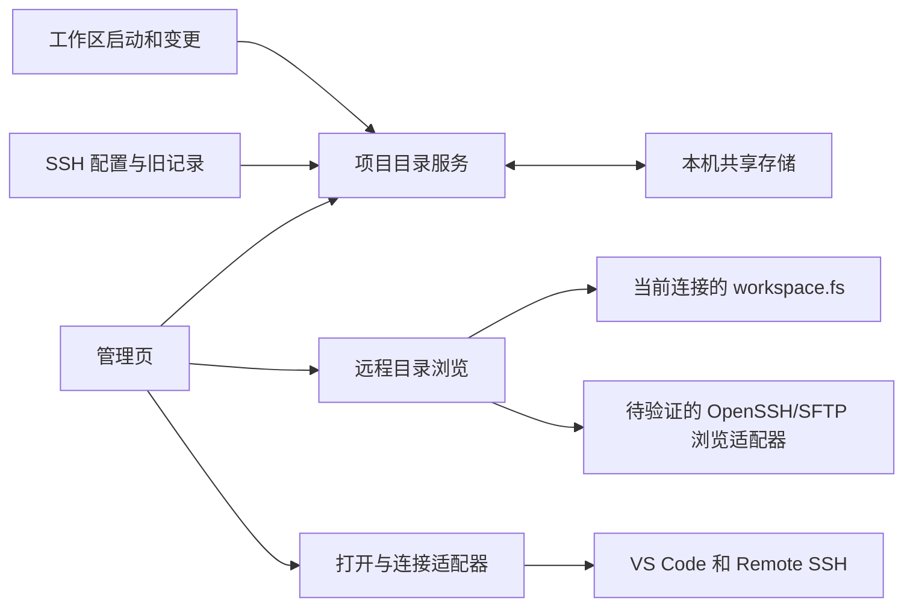

# SSH Workspace Manager：首版设计

状态：0.0.1 本机验证原型已实现并打包，真实服务器与 Windows 验收待完成。更新日期：2026-10-29。

当前交付实现了管理页、具体 SSH Host 导入、手动路径 / 收藏 / 搜索、根目录观察记录、带锁的本机共享存储、当前连接或独立 ssh2/SFTP 后台浏览，以及 Remote SSH 打开。已完成类型检查、本机 SSH/SFTP 协议测试、浏览器交互检查和 VS Code 1.139.0 开发宿主激活检查。以下文档还包含后续完整版本设计；旧历史导入、分组、中英文和复杂 SSH 配置尚未实现。试用步骤见 [体验测试](TRYOUT.zh-CN.md)。

## 1. 目标与确认范围

在 VS Code 编辑器区域辨认长路径、重新打开使用过的远程文件夹，并逐层浏览服务器目录以打开新项目。记录粒度是“服务器 + VS Code 打开的文件夹”。

| 决策 | 当前结果 |
| --- | --- |
| 路线 | 独立扩展，连接使用官方 Remote - SSH |
| 平台 | macOS、Windows 桌面 VS Code；远端主要是 Linux |
| 规模 | 10 台服务器以内，每台约 10 个常用目录以内 |
| 组织 | 服务器 → 项目文件夹 |
| 记录 | 自动记录实际打开的工作区根；可手动添加、命名、收藏 |
| 新目录 | 内嵌远程文件夹浏览区：单击选中、双击进入、选定后打开 |
| 打开 | 当前窗口/新窗口两个明确动作 |
| 旧数据 | 尽量导入已有目录记录，接受不完整 |
| 数据 | 本机保存，同一用户数据目录/配置档案的窗口共享 |
| SSH | 导入配置、添加显示元数据；连接参数沿用原配置 |
| 发布 | 先 VSIX 试用，稳定后准备 Marketplace |

用户希望从当前管理页触发后台连接，并在这里浏览。未找到官方 Remote SSH 无窗口连接并返回目录的稳定公开接口。优先研究“本机 OpenSSH/SFTP 轻量浏览 → 选定后 Remote SSH 打开”；官方远程窗口浏览保留为回退。该浏览通道是新增实现范围，认证与跨平台兼容性验证后再确定。[可行性核查](BACKGROUND-CONNECTION.zh-CN.md)

首轮验证使用本机 VS Code 1.139.0；最低支持版本在原型通过后确定。Linux 桌面端后续补实机验证。

## 2. 页面布局

入口：命令面板“SSH Manager: Open Dashboard”、状态栏和轻量侧栏的“打开管理页”。主界面使用编辑器 WebviewPanel。

- 左侧：服务器显示名称、原始 SSH 别名、分组；“全部服务器”用于查找已保存目录。
- 上方：最近打开与收藏的文件夹，展示名称、完整路径、最近打开时间，以及当前/新窗口按钮。搜索匹配服务器、名称、备注、路径。
- 下方：“打开新文件夹”浏览区，展示目标服务器、连接状态、路径栏、面包屑、上一级、刷新、子目录列表。
- 浏览区操作栏：显示“将打开”的完整路径。选中子目录时打开该子目录；没有选择时打开当前浏览目录。可选当前/新窗口。

长路径默认换行，主要操作始终可见。已保存目录搜索与远程浏览独立：输入搜索不会读取远端或改变浏览位置。浏览一次对应一台服务器；“全部服务器”视图先选择具体浏览目标。

## 3. 远程文件夹浏览

### 已连接服务器

1. 从可靠工作区 URI 确认 SSH authority；起点优先为上次成功浏览路径，其次为当前项目目录。失效时可回到父目录或输入新起点。
2. 只列当前层文件夹，按名称排列。目录符号链接显示标识；默认隐藏点目录，可切换显示。
3. 单击：选中子目录，显示其完整路径，保持当前层。
4. 双击：进入子目录、清除选择，更新路径栏与面包屑；不打开新工作区。
5. “上一级”与面包屑导航，根目录 `/` 禁用上一级。输入 Linux 绝对路径后按 Enter/“前往”直达。
6. 点击当前/新窗口才调用 VS Code 打开。未选子目录时可打开当前浏览目录，空目录也能打开。
7. 实际成为 VS Code 工作区后才进入最近打开记录。浏览不产生历史；先收藏的目录显示“尚未打开”。

键盘：原生 Tab 顺序，Space/Enter 选择目录行，行尾“进入”按钮等价于双击，兼顾键盘和触屏。路径栏 Enter 前往。

### 本地窗口、其他主机、断线

选择服务器只更新页面。目标不属于当前可信 authority 时，目标体验为“连接浏览”后仍留当前页。候选实现使用本机 OpenSSH/SFTP 获取目录；复用 SSH 配置、密钥与 agent，不保证复用 Remote SSH 登录会话。

认证顺序固定为：尝试 SSH agent/密钥 → 失败后提示密码（或加密私钥口令）→ 连接成功后显示目录。密码和口令只在本次浏览会话内存中使用，取消、断开或关闭页面即清除，不写配置、不写共享数据、不进入日志。输入密码不是默认首选，只有密钥/agent 认证失败且服务器允许密码认证时才显示。

先验证上述浏览通道，再决定是否纳入首版。SFTP 或认证工具不兼容时，回退到官方远程窗口；空窗口 + 管理页恢复仍需验证，无法获取可信 authority 时使用原生远程选择器取得目录 URI。不能仅修改 URI 主机就对当前连接列目录，也不把 `/` 当作临时项目打开。

连接中阻止重复提交，取消认证后可重试。断线保留浏览位置与已保存项目，目录区标记不可用，不把旧列表冒充实时数据。权限不足、目录不存在、空目录、网络错误分别呈现。进入失败时保留上次成功位置、清除误导性选择，允许返回上级/刷新。

### 状态边界

“当前浏览目录”“选中目录”“VS Code 工作区”独立。打开目标完整可见。切换服务器、导航、刷新后清除或重新验证选择。输入路径只按 POSIX 处理，不执行 shell、环境变量或 `~` 展开。

## 4. 扩展结构

TypeScript、esbuild、VS Code API；Webview 用轻量 DOM 和 VS Code 主题变量。`extensionKind: ["ui"]` 在各窗口本地扩展宿主运行。后台浏览候选调用本机 OpenSSH/SFTP，不自行实现 Remote SSH 的 VS Code Server 连接，不引入独立常驻服务。

模块：`SshConfigService`、`ProjectCatalog`、`WorkspaceRecorder`、`RecentImportAdapter`、`RemoteDirectoryService`、`OpenTargetService`、`LocalStore`、`DashboardPanel`。新增候选 `SshBrowseAdapter`，仅在浏览可行性验证通过后纳入实现。

### 数据

| 实体 | 字段 |
| --- | --- |
| Server | ID、原始 alias、已确认 authority 映射、显示名称、分组、备注、收藏、配置状态 |
| ProjectFolder | ID、serverId、完整 URI、名称、备注、收藏、lastOpenedAt、manual/observed/imported 来源 |
| BrowseState | serverId、当前 URI、选中 URI、隐藏目录偏好、请求序号；选择和加载状态仅存在当前面板 |
| Store | schemaVersion、revision、服务器、项目、每台上次成功浏览路径、导入状态、偏好 |

按 authority + 规范化路径去重，不合并同 IP 的不同别名。保留 URI 编码，避免重复解码 `%20`。Linux 路径区分大小写，Windows 本机也使用 POSIX 规则。符号链接按用户选择的路径保存，不强制按真实路径合并。

一个项目就是一个目录。多根工作区按各根记录，不承诺恢复 `.code-workspace` 整体布局。不保存密码、密钥、文件内容、文件访问事件或编辑位置。

### 目录读取

`RemoteDirectoryService.list({serverId, uri, requestId})` 按连接后端路由。当前工作区后端必须校验 scheme、authority 与当前连接一致，再调用 `workspace.fs.readDirectory`；后台浏览候选必须绑定指定 SSH 别名与会话，不能落到其他主机。前者用 `(type & FileType.Directory) !== 0` 识别目录和符号链接；SFTP 后端将属性转成统一目录模型。未知类型按需限并发核实，失败不猜作目录。

只读当前一级，不递归扫描或轮询所有主机。短时缓存标记读取时间，刷新绕过缓存，错误不能缓存为空成功列表。大目录取得列表后分批呈现；API 不支持服务端分页，分批渲染不能减少远端枚举量。

导航请求带递增序号，仅最新请求能更新当前视图；切换服务器、关闭面板、超时后丢弃旧结果。`readDirectory` 没有公开取消参数，UI 停止等待不等于底层请求已取消。宿主重新校验打开目标的服务器、目录与类型。

### SSH 配置

优先 `remote.SSH.configFile`，否则本机 `.ssh/config`，适配 Windows 用户目录。解析具体 Host 和递归 Include，限制深度 16、检测循环；通配规则不作为单独服务器。无法枚举的动态配置允许手动添加别名。

原始别名交给 Remote SSH 解析认证、ProxyJump、Match 等连接语义。配置缺失时保留项目和备注，标记“配置中未找到”。authority 编码兼容封装到适配器，实际观测 URI 优先于自行推导。

### 自动记录与导入

`onStartupFinished` 激活后读取当前窗口 SSH `workspace.workspaceFolders`，监听 `onDidChangeWorkspaceFolders`。第一根替换可能重启宿主，通过新实例启动观察补记录。普通聚焦、浏览、发起打开但取消认证，都不更新最近打开时间。

手动添加/收藏无需在线，`lastOpenedAt` 为 `null`。目标窗口实际观察到工作区根后才确认时间。合并不覆盖名称、备注、收藏。旧导入无时间显示“时间未知”，手动未打开显示“尚未打开”。

收藏、历史和手动目录均提供逐条“删除记录”入口。取消收藏仅清除星标；删除记录移除此目录的收藏与历史元数据，不删除远端目录、不改写 SSH 配置。删除结果在落盘后提示，同一配置档案的其他窗口同步更新；重复删除按成功处理。再次实际打开该目录时允许重新记录。

旧导入尽力使用 `_workbench.getRecentlyOpened` 中可靠 SSH 文件夹条目；无法可靠得到根目录的 `.code-workspace` 跳过并报告。接口失效不影响持续采集，不读私有数据库。提供暂停记录、清除最近记录与移除项目；只操作元数据，收藏可保留。

按约 100 目录规模不自动淘汰，后续增长再加可配置保留策略。

### 本机共享

`globalStorageUri` 下版本化 JSON，使用 [proper-lockfile](https://github.com/moxystudio/node-proper-lockfile) 跨进程互斥、临时文件原子替换。锁内重读最新 revision 并应用字段级操作，避免旧快照覆盖其他窗口修改；统一锁参数并处理锁失效。

观察事件 500ms 内合并落盘，显式编辑落盘后才报告成功。目录监听加聚焦补读，跨窗口目标 2 秒内可见。写失败保留队列、有限重试；损坏保留原文件并恢复有效备份。共享限同一用户数据目录/配置档案，Stable/Insiders、不同 profile 不保证互通。

### 打开与连接

`vscode.openFolder(uri, {forceReuseWindow: true})` / `{forceNewWindow: true}` 表达打开方式；切换前刷新待写元数据。当前连接下浏览出的目录先 `stat` 确认仍为目录；已保存离线入口可直接交给 Remote SSH 连接。

后台浏览与正式编辑使用独立连接阶段，不能把轻量浏览就绪显示为“Remote SSH 已连接”。只有点击打开时调用官方编辑连接。后台浏览的认证状态和 Remote SSH 的编辑认证状态分别显示，避免用户误以为密码已被共享。官方窗口回退在 A 阶段验证 `vscode.newWindow` remoteAuthority 参数和连接命令；恢复请求带有效期、目标 authority、一次性标识，不被无关窗口领取。

未保存更改、认证、连接错误沿用 VS Code 流程。命令返回不等于成功，目标窗口工作区观察才更新记录。

### 命令与协议

命令前缀 `sshWorkspaceManager.*`：`openDashboard`、`quickOpen`、`saveCurrentFolder`、`importRecentFolders`、`openSshConfig`、`pauseRecording`、`clearRecentFolders`。

Webview → Host 带 requestId 的消息：`ready`、`selectServer`、`searchFolders`、`saveFolder`、`updateServer`、`setFavorite`、`removeFolder`、`connectForBrowse`、`listDirectories`、`openFolder`、`importRecentFolders`。浏览附 serverId、目录 URI、请求序号；打开附 `windowMode: "current" | "new"`。

Host → Webview：snapshot/revision、目录列表、连接/加载状态、动作结果和错误。校验消息与 URI 归属，不接受任意命令或 shell 文本。使用 CSP、资源白名单和文本节点；中英文文案分离。

## 5. 推进与验收

### A. 最小真实连接验证

先验证认证方式和本机 OpenSSH/SFTP 的目录浏览可行性，再在开发宿主验证：当前页后台浏览 → 选中/进入 → 当前/新窗口由 Remote SSH 打开 → 自动记录根目录。已连接目标用 `workspace.fs`，官方窗口回退、空窗口起点与多窗口共享也需验证。

macOS 与 Windows 各连接 Linux 完成闭环。不同 authority 必须被拦截；权限、取消认证、失效路径可恢复。自动恢复不通过时明确记录回退，不能隐藏为已支持。

### B. 首个 VSIX

管理页、配置导入、最近文件夹、名称收藏搜索、远程浏览、两种打开方式、旧目录尽力导入、本机共享、中英文和说明。

验收：辨认同名不同路径项目并重开；浏览找到未保存目录，打开后在最近列表找到；多个窗口使用后能查看统一记录。离线能整理已保存项目。

### C. 稳定与商店

完成跨平台、主题、可访问性、异常恢复和打包测试，准备 README、截图、CHANGELOG、LICENSE、隐私说明、反馈地址与 publisher。先预发布，再稳定版。暂名 SSH Workspace Manager，公开前确认标识可用性。实际上传在发布包可审查后单独执行。

### 核心场景

- 配置：自定义路径、Windows、Include 通配/相对/循环、多别名、动态配置、配置消失。
- 浏览：单击不导航、双击只导航、键盘进入、空目录、上级/根、面包屑、直达、隐藏目录、符号链接、权限与删除。
- 上下文：本地/当前 SSH/另一 SSH/空窗口；快速切换后旧结果不覆盖；断线不冒充实时。
- 认证：agent/密钥成功不显示密码、密钥失败后密码框、取消/错误重试、密码不落盘、不出现在日志，Remote SSH 编辑连接是否再次认证。
- 路径：中文、空格、`#`、`%`、大小写、超长、同 IP 不同别名、相对路径与控制字符。
- 记录：启动已有目录、多根、第一根替换后重启、暂停、去重；浏览与取消不记成功。
- 打开：选中子目录与当前目录区分、当前/新窗口、跨主机、已有目标窗口、未保存修改与取消。
- 存储：并发字段更新、锁失效、损坏、重复导入、时间未知、内部命令缺失。
- 体验：长路径、深浅主题、键盘、800/1,280px；100 目录暖搜索目标 p95 < 100ms，跨窗口目标 2 秒内可见；远程枚举单独测量。

## 6. 当前交付与边界

当前为调研、设计与可交互草图。草图用虚构主机和目录树模拟选择、进入、打开，不连接真实服务器。交互和布局在修改后重新检查，不能代替扩展、Windows 或真实 SSH 验收。

当前草图演示管理页保持可见、后台连接示意和密码提示状态；数据仍是虚构目录，未连接真实服务器，不能视为后台适配器已实现或已验证。

本轮草图检查通过：单击选中不导航、双击进入不记历史、选中子目录/空目录打开、面包屑与根目录边界、隐藏目录、权限/路径错误、切换主机先连接、当前/新窗口目标、搜索收藏、中文与特殊字符、手动添加去重。在 320、360、510、736、1,024px 检查宽度下未发现横向溢出，未捕获脚本错误。

首版包括按需逐层列目录；不做递归索引、源码内容搜索、SFTP 同步、文件访问记录、整套窗口恢复、跨电脑同步或团队共享。
